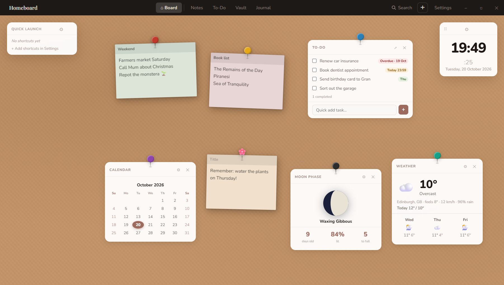

# Homeboard

A cosy personal pinboard for your desktop: sticky notes, image pins and widgets on a cork board, plus a to-do list, project notes, an encrypted password vault and an encrypted journal.



**Try it in your browser:** https://alissa-blackham.github.io/homeboard/ (it can be installed as an app from there too)

## What's in it

- **The board.** Drag sticky notes, image pins, washi tape, stickers and cards around, and change pins, colours, frames and backgrounds.
- **Widgets.** To-do, notes, vault, weather, calendar, pomodoro, habits, countdown, moon phase, now playing, quote, photo strip, journal, and quick-launch app shortcuts.
- **To-dos with due dates.** Overdue / Today / Tomorrow labels, plus a reminder when something comes due (at 9am, or at the time you set).
- **Search everything.** Press `Ctrl+K` to search to-dos, notes, the board, vault names, the journal (once it's unlocked) and apps.
- **Vault & journal.** AES-256-GCM encryption with one master password. They lock themselves after a few idle minutes and when the window is minimised (you can change both in Settings).
- **Backups.** The desktop app keeps a daily copy of your data for two weeks. You can export or import a backup file from Settings on both desktop and web.

## Running it

The desktop app is built with Electron.

```bash
npm install
npm start
```

Other commands:

| Command | What it does |
| --- | --- |
| `npm run build:win` | Builds the portable `dist/Homeboard.exe` |
| `npm run build:web` | Bundles `renderer/` into `docs/index.html` (the web version on GitHub Pages) and `Homeboard.html` (a standalone single file) |

After changing anything in `renderer/`, run `npm run build:web` so the web version picks it up.

## Where your data lives

- **Desktop:** `%APPDATA%\homeboard\homeboard-data.json`, with daily copies in the `backups` folder next to it (Settings → Backup → *Open daily backups folder*).
- **Web:** this browser's local storage only. Export a backup now and then.

If you forget the master password, the vault and journal can't be recovered.

## Layout

```
main.js            Electron main process: window, saving/backups, file dialogs, encryption
preload.js         The bridge (window.hb) between the page and main.js
renderer/          The app itself (index.html, renderer.js, styles.css)
build-web.ps1      Builds the web versions, swapping window.hb for browser equivalents
docs/              GitHub Pages site (generated index.html, service worker, manifest, icons)
```
